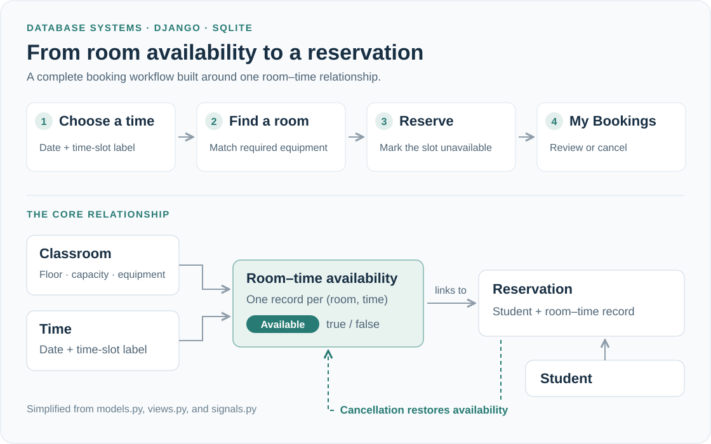

# University Study Room Booking System

A Django application that connects a room's physical resources with its availability over time. Users choose a time slot, find rooms with the equipment they need, and manage reservations through a personal dashboard. Administrators manage rooms, schedules, and accounts through Django Admin.

Built by **Xingyu Zhao** for *Introduction to Database System* at Fudan University, Spring 2024. The project brings together relational data modeling, server-side application logic, and a Bootstrap interface in a complete local booking workflow.

**[Project report](Project%20Report.pdf)** · **[Video walkthrough](Studyroom-Booking%20System%20Demo%20%28with%20audio%29.mov)** (MOV with audio, ~90 MB) · **[Local setup](docs/setup.md)**

*Code-based workflow illustration. The diagram simplifies the schema; it is not an application screenshot.*

## What the application demonstrates

- **Resource discovery:** browse dated time slots and inspect each available room's floor, capacity, and equipment. A comma-separated equipment query requires every listed item to be present.
- **Reservation lifecycle:** create a reservation, see it in “My Bookings,” and cancel it to make the room available again for that slot.
- **User-specific views:** Django authentication connects accounts to student records and personal profiles. Student profiles see study rooms, with meeting rooms excluded from their room listing.
- **Administrative data management:** add rooms, time slots, students, and profile types through Django Admin. Model signals automatically create room–time availability records when a room or time slot is added.

## How the data model works

The central modeling choice is to separate a **room** from a **room at a particular time**. `Classroom_info_by_time_slot` joins `Classroom` and `Time`, with a uniqueness constraint on the pair and an availability flag. A `Reservation` connects a `Student` to that room–time record.

Saving a reservation marks the room–time record unavailable. The cancellation view restores availability before deleting the reservation. Account identity is held in Django's `User` model; `Student` and `Profile` each have a one-to-one relationship with it. `Profile.user_type` determines which rooms appear in the listing.

The main request path is **Django URLs → reservation views → ORM / SQLite → Django templates**, with Bootstrap 5.3.3 providing the interface components. This makes the relationship between database design and visible application behavior easy to inspect.

## Try it locally

See the **[local demo guide](docs/setup.md)** for the Python environment, dependency setup, database initialization, and a small room/student example. The guide uses the project's original Django 5.0.6 version and explains the bundled `booking` dependency.

The application starts at `/login/` or `/admin/`; there is no route at `/`. A demo student needs both a `Student` record and a linked `Profile` before browsing rooms.

## Source guide

| File or directory | What to look for |
| --- | --- |
| [`reservation/models.py`](Studyroom_Booking_Code/reservation/models.py) | Entity relationships, room–time uniqueness, reservation state updates |
| [`reservation/views.py`](Studyroom_Booking_Code/reservation/views.py) | Equipment matching, profile-based room listing, booking and cancellation |
| [`reservation/signals.py`](Studyroom_Booking_Code/reservation/signals.py) | Automatic creation of room–time availability records |
| [`reservation/admin.py`](Studyroom_Booking_Code/reservation/admin.py) | Administrative forms and model registration |
| [`reservation/templates/`](Studyroom_Booking_Code/reservation/templates) | Login, profile, room search, confirmation, and booking-list pages |
| [`reservation/migrations/`](Studyroom_Booking_Code/reservation/migrations) | Database schema history |
| [`classroom_reservation/`](Studyroom_Booking_Code/classroom_reservation) | Project settings and URL routing |
| [`dj-booking-main/`](Studyroom_Booking_Code/dj-booking-main) | Bundled third-party booking package, separately routed under `/booking/` |

The custom room-booking workflow described here lives in `reservation/`. Features described in the bundled `dj-booking` documentation belong to that separate package.

## Project scope

This is a database course prototype. It illustrates the sequential booking workflow, but does not yet implement transactional protection against simultaneous bookings or complete authorization checks for booking and cancellation. Student/faculty filtering is applied to the room listing, rather than enforced as a complete permission system. The development settings and account storage would also need revision before deployment. The custom application's `tests.py` is currently a scaffold.

## License and attribution

Copyright &copy; 2025, Peter Xingyu Zhao. The original project content is provided under [Creative Commons Attribution–NonCommercial 4.0 International](https://creativecommons.org/licenses/by-nc/4.0/) ([license text](https://creativecommons.org/licenses/by-nc/4.0/legalcode)). Bundled third-party components retain their own licenses and attribution; `dj-booking` is by Foad Heidari and is distributed under the MIT license.
